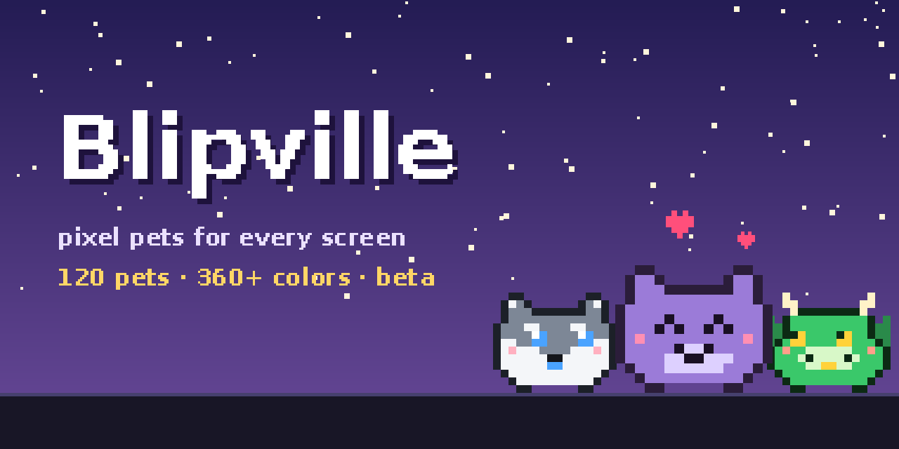
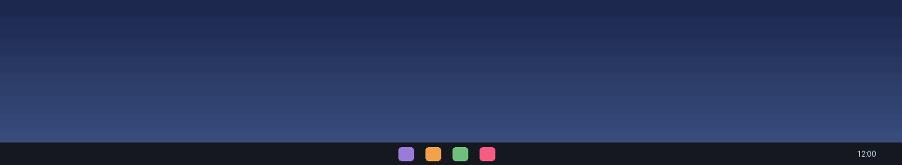

# 🏘️ Blipville



> 🧪 **Beta demo.** Blipville is still being built. Expect new animals, changes and the odd bug. [Tell me what you think!](https://github.com/Johnblip189/blipville/issues/new/choose)

Tiny pixel pets that live on top of your taskbar. They wander around, nap, chase your mouse, eat cookies, say hi to each other — and you can pick them up and throw them.



**108 kinds of pets · 328+ colors · hearts, eggs & a minigame** — one Python file, nothing to install.

## Get it

### Windows: just download and run

**[⬇️ Download Blipville.exe (beta)](https://github.com/Johnblip189/blipville/releases/download/v0.1.0-beta/Blipville.exe)**, then double-click it. A little pet drops onto your taskbar. 🎉

> Windows may say **"Windows protected your PC"** the first time, because the app isn't signed (signing costs money).
> Click **More info → Run anyway**. You only need to do this once.

### Any computer with Python

1. Install [Python](https://www.python.org/downloads/) (on Windows, tick **"Add python.exe to PATH"** during setup).
2. Download [`blip.pyw`](blip.pyw) and double-click it, or run `python blip.pyw`.

> Made for **Windows**. Should also work on **macOS**. (On Linux the pet shows up in a pink box, because most Linux desktops don't support see-through windows from Python.)

## Playing with your pets

| Do this | What happens |
|---|---|
| **Click** a pet | Pets it: hearts, a happy hop, a cute line |
| **Drag** a pet | Picks it up. Let go to **throw** it, and it bounces off the screen edges |
| **Right-click** a pet | Opens the menu ⬇️ |
| **Leave it alone** | It wanders, talks, watches your mouse, gets hungry, and naps when tired or late at night |

**Right-click menu**

- **Feed a cookie**: a cookie drops in, and the pet walks over and munches it
- **Pet** / **Nap time** / **Say something**
- **Follow my mouse**: the pet chases your cursor along the taskbar
- **Change kind**: switch between every kind you've unlocked
- **Change color**: every animal has its own real-life colors (tabby cat, husky, red panda, orca…)
- **Rename…**: give it any name
- **Add a friend**: another random pet joins (up to 12). Pets that meet say hi to each other by name
- **Play Night Shift 🌙…**: the minigame that unlocks the robo crew
- **🥚 Hatch a Mystery Egg…**: spend hearts to hatch a rare Blip (your heart count is shown in the menu)
- **Suggest an animal…**: opens the request form in your browser
- **Support Blipville ♥**: ways to support the project
- **Show name tags**, **Goodbye [name]**, **Goodbye everyone (quit)**

The pets don't show up on the taskbar, so use **right-click → Goodbye everyone** to close them.

## The zoo

**Critters:** Blip, Bun *(hops)*, Sprout, Boo *(floats)*, Fuzz *(flutters)*, Spike

Blip can even dress up as a **Husky** or a **German Shepherd** (right-click Blip → Change color).

**Night Shift 🌙:** Robo Bear, Robo Bunny *(hops)*, Robo Hen. Creaky little animatronics with bolts and hinged jaws. Between 10 PM and 6 AM their eyes glow and they get… chatty. 🔒 You have to **earn** them in the Night Shift minigame ⬇️

**Animals:** Armadillo, Axolotl, Bat, Bear, Beaver, Bee, Butterfly, Capybara, Cat, Caterpillar, Chameleon, Chick, Chinchilla, Clownfish, Corgi, Cow, Crab, Crocodile, Dalmatian, Deer, Dog, Dolphin, Donkey, Dragon, Duck, Elephant, Fennec, Ferret, Flamingo, Fox, Frog, Gecko, Giraffe, Goat, Goldfish, Guinea Pig, Hamster, Hedgehog, Hippo, Horse, Jellyfish, Kangaroo, Koala, Ladybug, Lemur, Lion, Llama, Meerkat, Mole, Monkey, Mouse, Octopus, Otter, Owl, Panda, Parrot, Penguin, Pig, Pufferfish, Pug, Rabbit, Raccoon, Rhino, Seal, Shark, Sheep, Shiba, Skunk, Sloth, Snail, Snake, Squirrel, Starfish, Tiger, Turtle, Unicorn, Whale, Wolf, Zebra

Each animal has its own lines and its own way of moving: frogs and kangaroos hop, bats, bees and butterflies flutter, whales and fish float, sloths and snails are *very* slow, flamingos stand on one leg, and chameleons change color on their own.

**Rare 🥚:** 20 secret Blips you can only hatch from Mystery Eggs. No spoilers, but one of them is *very* shiny. ✨


## 💖 Hearts & Mystery Eggs

Taking care of your Blips earns **hearts**:

| Do this | Hearts |
|---|---|
| 💖 Pet a Blip | +1 |
| 🍪 Feed it a cookie | +3 (+5 if it was hungry) |
| 💤 Let it nap until it's rested | +2 |
| 🎁 Open Blipville on a new day | +10 daily treat |
| 🌙 Survive a night in Night Shift | +10 (+25 the first time) |

Spend **30 hearts** on a **🥚 Mystery Egg** (right-click any pet). It wobbles, cracks, and hatches one of the 20 rare Blips, which then joins you on the desktop. Collect them all!

## 🌙 Night Shift (minigame)

Right-click any pet → **Play Night Shift 🌙…**

Survive from **12 AM to 6 AM** (about 2 minutes) while the Night Shift crew wanders toward your office.

- **Glowing eyes in a doorway?** Hit **FLASH** on that side (◀ ▶ or **A** / **D**) to send the robo back to the stage.
- **Check the cameras** (**1**–**5**): a robo you're watching **can't move**. But cameras and flashes use battery 🔋
- Get caught and you just try again. No real jump scares, promise. (It just wanted a hug.)

| Survive | Unlocks |
|---|---|
| Night 1 | 🤖 Robo Bear |
| Night 2 | 🤖 Robo Bunny |
| Night 3 | 🤖 Robo Hen |

Your progress is saved, and each robo you unlock drops straight onto your desktop.

## Start pets automatically with Windows

1. Press **Win + R**, type `shell:startup`, and press Enter.
2. Right-click `Blipville.exe` (or `blip.pyw`) → **Create shortcut**, then move the shortcut into that folder.

## Your own custom Blips ⭐

Want a Blip of *you*, your Roblox avatar, or your real pet? Make a file called **`my_blips.json`** next to `Blipville.exe` (or `blip.pyw`):

```json
{
  "blips": [
    {
      "name": "My Blip",
      "eyes": 5,
      "lines": ["hi, it's me!"],
      "body": ["..oo........oo..", "...12 rows of 16 characters..."],
      "colors": {"o": "#2b1d3a", "b": "#9b7bd8", "l": "#ddd0ff", "p": "#ff8fb3", "e": "#1a1024"}
    }
  ]
}
```

Each letter in `body` is a color from `colors` (`.` is see-through, `o` is the outline, `e` is the eye color). Your Blips show up under **Change kind → My Blips ⭐**. The file stays on your computer and isn't part of this repo.

## Adding your own animal

Every pet is 16 × 12 pixel art written as text, right inside `blip.pyw`. For example, the cat:

```python
".o............o.",   # o = outline   b = body    l = belly / muzzle
".oao........oao.",   # a = inner ear  p = cheeks  n = nose
".oaboooooooobao.",   # . = see-through
".obbbbbbbbbbbbo.",
...
```

Copy an animal in the `ANIMALS` section, change the drawing and colors, and give it some lines in `ANIMAL_TRAITS`. The face (eyes, blinking, mouth) is drawn on top automatically.

## Want a new animal?

**[🐾 Suggest an animal](https://github.com/Johnblip189/blipville/issues/new?template=new-animal.yml)** — or right-click any pet → **Suggest an animal…**

Found a bug? **[Report it here](https://github.com/Johnblip189/blipville/issues/new?template=bug.yml)**.

## Support Blipville

Blipville is free, and the main game always will be. If you'd like to help it grow:

- 💜 **Pay what you want on itch.io** — *coming soon*
- ☕ **Leave a tip** — *coming soon*
- 🐶 **Get your own pet turned into a Blip** (custom pet, from a photo) — *coming soon*
- ⭐ **Free ways that help a lot:** star this repo, share the GIF with a friend, or [suggest an animal](https://github.com/Johnblip189/blipville/issues/new?template=new-animal.yml)

You can also right-click any pet → **Support Blipville ♥**.

## License

[MIT](LICENSE): do whatever you like, just keep the credit.
