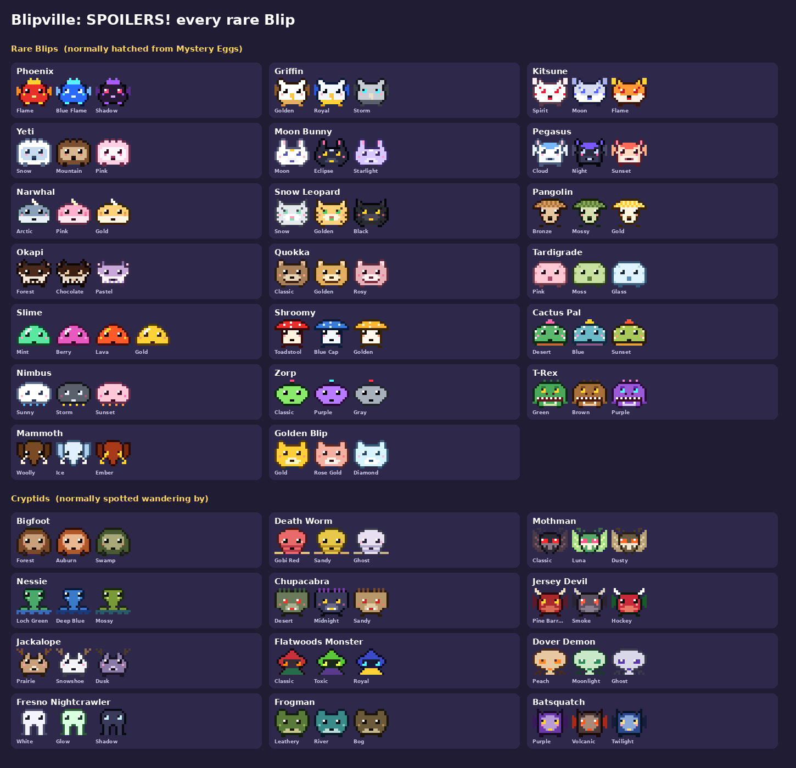

# 🏘️ Blipville


> 💬 **[Join the Blipville Discord!](https://discord.gg/Q3zmYakNZT)** Chat, share your town, report bugs and suggest Blips.

> 💜 **Blipville 1.0 is here!** Thank you to everyone who played the betas. Spot a bug or have an idea? [Tell me!](https://github.com/Johnblip189/blipville/issues/new/choose)

Tiny pixel pets that live on top of your taskbar. They wander around, nap, chase your mouse, eat cookies, say hi to each other — and you can pick them up and throw them.


**260 kinds of pets · 820+ colors · hats, hearts, eggs, cryptids, kaiju, ghosts, trophies & a minigame** — one Python file, nothing to install.

## ✨ New in 1.0

**[⬇️ Download Blipville.exe (1.0)](https://github.com/Johnblip189/Blipville/releases/latest/download/Blipville.exe)**

- 🚫 **No more black flashes.** Blipville used to hide a "magic pink" background that Windows had to repaint whenever
  you clicked a pet or opened a menu, and sometimes it showed black for a moment. 1.0 runs on the **Redux engine**: it
  draws every pet as a real see-through picture and hands it straight to Windows, so nothing gets repainted.
- 🪟 **Blips climb your windows** (Windows app only): they jump onto open windows, ride along when you drag them, and tumble down when you close them.
- 🖱️ **They play with your mouse** (Windows app only): wiggle the pointer and they chase it, pounce, and sometimes steal it for a second.
- ⚔️ **The Arena:** battle with a team of 3. Share your **battle code** so friends can battle your team (works between Windows and the browser).
- ✨ **20 Awakened forms**, including every kaiju, ghosts like King Sheetie and cryptids like Lunar Mothman, with one Awaken per Arena battle.
- 🎨 **Accessory colors** and a **2nd accessory slot**.
- 👻 **Ghosts:** a new tier of 10 ghosts that drift by at night. Click one while it glows! (Or light a 🕯️ Spirit Candle.)
- 🏆 **Trophies:** 27 of them, each worth bonus hearts. Right-click a pet → 🏆 Trophies.
- 🎨 **Redraws** of the 10 roughest Blips.
- 🔧 **Patch**, a free thank-you gift for waiting out the maintenance (until Tuesday, November 24).
- 🛠️ **Maintenance mode**, so a big fix never leaves you with a broken app.
- 💾 Your pets, hearts, worlds and unlocks come with you. Blipville and Blipville Redux both offer the update by themselves.

## Earlier versions

### v0.4.0 (release candidate 2)

**Thank you for playing our beta!** 💜 Every pet you hatched, cryptid you spotted and idea you sent helped shape Blipville. This is **Release Candidate 2**, the last step before **1.0**, and it comes with:


- 🐾 **100 new Blips!** 50 new animals (Badger, Cheetah, Moose, Platypus, Peacock, Poodle, Koi and lots more), plus 5 brand-new tabs:
  - 🦕 **Dinos:** Triceratops, Stegosaurus, Brachiosaurus, Pterodactyl, Raptor and more
  - 🌊 **Ocean:** Seahorse, Stingray, Squid, Lobster, Anglerfish and more
  - 🍩 **Sweets:** Donut, Cupcake, Ice Cream, Gummy Bear, Taco and more
  - 🚀 **Space:** Astronaut, UFO, Star, Moon, Rocket, Black Hole and more
  - 🌱 **Plants:** Sunflower, Tulip, Flytrap, Pumpkin, Lotus and more
- 🔄 **Auto-updates:** the desktop app now checks for new versions and updates itself (it always asks first). Right-click a pet → **🔄 Updates**.
- 🌍 **Worlds:** the Dinos, Ocean, Sweets, Space and Plants tabs are now worlds. Unlock one with hearts (50–150 💖) to pick its Blips, then visit it any time: right-click a pet → **🌍 Worlds** (on phones and laptops, tap **🌍 Worlds**). Each world has its own sky and ground on the phone version. Blips you already had stay yours.
- 🌟 **World Legends:** each world hides 2 legendary Blips (10 in all: Mossling, Bloomkin, Gumdrop Golem, Cotton Candy Cloud, Pearlfin, Abyss Wisp, Fossilbones, Amber Raptor, Nebula Cat, Cosmo Pup). They only stroll by while you're visiting their world, sparkling in full color. Click one before it leaves!
- 🎁 **A free gift:** everyone who plays this week gets **Beta Buddy**, a limited-edition party Blip, in the new Gifts tab. **This week only** (until Sunday, November 22)!

### v0.3.4 (beta)

- 💬 **Suggestions & help** in every pet's right-click menu: suggest an animal or an idea, or get help if you're stuck.
- 💖 **Donate / support Blipville** button.

### v0.3.3 (beta)

- 🎨 **More redraws:** Ladybug, Hippo, Nessie and Goldfish got makeovers.

### v0.3.2 (beta)

- 🦖 **New rarity: Kaiju!** 5 giant monsters (Tidal Titan, Magmaw, Gigabot, Skyray and Frostback) that stomp through a little city at the bottom of your screen. They're **way** harder to get than cryptids: they show up rarely, move fast, and you have to click one **3 times** before it leaves. Or switch on a 📡 Kaiju Beacon.
- 👣 **13 more cryptids:** Thunderbird, Hodag, Mokele-mbembe, Lizard Man, Kappa, Tsuchinoko, Owlman, Beast of Bodmin, Pope Lick Monster, Bunyip, Skunk Ape, Wendigo and Snallygaster, each with its own scene.
- 🎨 **Redrawn Blips:** Mothman, Flamingo, Snake, Capybara, Butterfly, Death Worm, Dover Demon and Fresno Nightcrawler got makeovers.

### v0.3.1 (beta)

- 👣 **New rarity: Cryptids!** 12 Blips based on legendary creatures (Bigfoot, Mothman, Nessie and more). Spot one in its own little scene, like Mothman on a lamp post, and click it before it gets away. Or set out a 🔦 Cryptid Lure.

### v0.3.0 (beta)

- 🏠 **Your pets are remembered.** Close Blipville and your whole town comes back next time, names, colors and hats included.
- 🎩 **Hats & outfits shop.** Spend hearts on 12 hats and outfits, plus seasonal ones that only show up at the right time of year.
- 🍂 **Seasons & weather.** Snow in winter, petals in spring, fireflies on summer nights, falling leaves in autumn, and bats around Halloween. Pets have seasonal things to say too.
- ⚽ **Pets play together.** They play catch, chase each other in games of tag, and pile up for naps.
- 🔊 **Cute sound effects** (off by default). Boops, munches, a coin ding for new hats, and an egg-hatching fanfare. All made with code.
- 👀 **Peek at locked Blips.** Don't want to wait? Peek at the rare and Night Shift Blips in the Collection (with a spoiler warning first).

## Get it

### Windows: just download and run

**[⬇️ Download Blipville.exe](https://github.com/Johnblip189/Blipville/releases/latest/download/Blipville.exe)**, then double-click it. A little pet drops onto your taskbar. 🎉

> Windows may say **"Windows protected your PC"** the first time, because the app isn't signed (signing costs money).
> Click **More info → Run anyway**. You only need to do this once.

### Any computer with Python

1. Install [Python](https://www.python.org/downloads/) (on Windows, tick **"Add python.exe to PATH"** during setup).
2. Download [`blip.pyw`](blip.pyw) and double-click it, or run `python blip.pyw`.
3. Optional, on Windows: `pip install pillow` turns on the Redux engine (no black flashes). Without it, Blipville
   still runs and uses the older see-through trick.

> Made for **Windows**. Should also work on **macOS**. (On Linux the pet shows up in a pink box, because most Linux desktops don't support see-through windows from Python.)

## Playing with your pets

| Do this | What happens |
|---|---|
| **Click** a pet | Pets it: hearts, a happy hop, a cute line |
| **Drag** a pet | Picks it up. Let go to **throw** it, and it bounces off the screen edges |
| **Right-click** a pet | Opens the menu ⬇️ |
| **Leave it alone** | It wanders, talks, watches your mouse, gets hungry, and naps when tired or late at night |

**Right-click menu**

- **Feed a cookie**: a cookie drops in, and the pet walks over and munches it
- **Pet** / **Nap time** / **Say something**
- **Follow my mouse**: the pet chases your cursor along the taskbar
- **Change kind**: switch between every kind you've unlocked
- **Change color**: every animal has its own real-life colors (tabby cat, husky, red panda, orca…)
- **Rename…**: give it any name
- **Add a friend**: another random pet joins (up to 12). Pets that meet say hi to each other by name
- **Play Night Shift 🌙…**: the minigame that unlocks the robo crew
- **🎩 Hats & outfits…**: buy, wear and swap hats with your hearts
- **🥚 Hatch a Mystery Egg…**: spend hearts to hatch a rare Blip (your heart count is shown in the menu)
- **🔦 Set out a Cryptid Lure…**: spend hearts to make a cryptid sneak by soon
- **📡 Switch on a Kaiju Beacon…**: spend 100 hearts to call a kaiju
- **📖 Collection…**: every rare, Night Shift, cryptid and kaiju Blip. Locked ones are shadows, but you can peek
- **Sound effects** / **Weather effects**: turn sounds on (they start off) and seasonal weather off
- **💬 Suggestions & help**: suggest an animal or an idea, or get help if something's wrong
- **💖 Donate / support Blipville…**: ways to support the game
- **Support Blipville ♥**: ways to support the project
- **Show name tags**, **Goodbye [name]**, **Goodbye everyone (quit)**

The pets don't show up on the taskbar, so use **right-click → Goodbye everyone** to close them.

## The zoo

**Critters:** Blip, Bun *(hops)*, Sprout, Boo *(floats)*, Fuzz *(flutters)*, Spike

Blip can even dress up as a **Husky** or a **German Shepherd** (right-click Blip → Change color).

**Night Shift 🌙:** Robo Bear, Robo Bunny *(hops)*, Robo Hen. Creaky little animatronics with bolts and hinged jaws. Between 10 PM and 6 AM their eyes glow and they get… chatty. 🔒 You have to **earn** them in the Night Shift minigame ⬇️

**Animals:** Armadillo, Axolotl, Bat, Bear, Beaver, Bee, Butterfly, Capybara, Cat, Caterpillar, Chameleon, Chick, Chinchilla, Clownfish, Corgi, Cow, Crab, Crocodile, Dalmatian, Deer, Dog, Dolphin, Donkey, Dragon, Duck, Elephant, Fennec, Ferret, Flamingo, Fox, Frog, Gecko, Giraffe, Goat, Goldfish, Guinea Pig, Hamster, Hedgehog, Hippo, Horse, Jellyfish, Kangaroo, Koala, Ladybug, Lemur, Lion, Llama, Meerkat, Mole, Monkey, Mouse, Octopus, Otter, Owl, Panda, Parrot, Penguin, Pig, Pufferfish, Pug, Rabbit, Raccoon, Rhino, Seal, Shark, Sheep, Shiba, Skunk, Sloth, Snail, Snake, Squirrel, Starfish, Tiger, Turtle, Unicorn, Whale, Wolf, Zebra

Each animal has its own lines and its own way of moving: frogs and kangaroos hop, bats, bees and butterflies flutter, whales and fish float, sloths and snails are *very* slow, flamingos stand on one leg, and chameleons change color on their own.

**Rare 🥚:** 20 secret Blips you can only hatch from Mystery Eggs. No spoilers, but one of them is *very* shiny. ✨

**Cryptids 👣:** 25 legendary creatures from folklore and blurry photos. You can't hatch or buy them: you have to **spot** them ⬇️

<details>
<summary>⚠️ <b>Spoilers:</b> don't want to hunt for them? Click to see every rare Blip and cryptid</summary>

<br>



</details>


## 💖 Hearts & Mystery Eggs

Taking care of your Blips earns **hearts**:

| Do this | Hearts |
|---|---|
| 💖 Pet a Blip | +1 |
| 🍪 Feed it a cookie | +3 (+5 if it was hungry) |
| 💤 Let it nap until it's rested | +2 |
| 🎁 Open Blipville on a new day | +10 daily treat |
| 🌙 Survive a night in Night Shift | +10 (+25 the first time) |

Spend **30 hearts** on a **🥚 Mystery Egg** (right-click any pet). It wobbles, cracks, and hatches one of the 20 rare Blips, which then joins you on the desktop. Collect them all!

You can also spend hearts in the **🎩 Hats & outfits** shop: party hats, bows, crowns, wizard hats and more, from 💖 15 to 💖 50. Some only appear in their season, like the Santa Hat in winter or the Witch Hat around Halloween.

## 👣 Cryptid sightings

Every so often (more often at night), a cryptid shows up near the bottom of your screen as a **shadow with glowing eyes**, and each one appears its own way, just like in the stories: Mothman lands on a flickering **lamp post**, Nessie pops out of the **water**, Bigfoot walks behind the **pine trees**, the Fresno Nightcrawler strolls past on **security camera** footage… Your pets will drop a hint when something's out there. **Click it before it gets away** and the cryptid becomes your Blip! If you miss it, your pets will definitely have seen *something*.

- Can't wait? Right-click any pet → **🔦 Set out a Cryptid Lure** (20 💖) and one shows up within a minute.
- See which ones you've spotted in **📖 Collection** (right-click a pet), or under **Change kind → Cryptids 👣**.

## 🦖 Kaiju

Kaiju are like cryptids, but **much** harder. Once in a long while the ground starts shaking and a giant monster stomps (or swims, or flies) through a tiny city at the bottom of your screen. **Click it 3 times** before it leaves to befriend it. The little bars above it show how many hits you've landed.

- Kaiju only show up about once every hour or so.
- Can't wait? Right-click any pet → **📡 Switch on a Kaiju Beacon** (100 💖) and one comes within a minute.
- Find them under **Change kind → Kaiju 🦖** and in **📖 Collection**.

## 🌙 Night Shift (minigame)

Right-click any pet → **Play Night Shift 🌙…**

Survive from **12 AM to 6 AM** (about 2 minutes) while the Night Shift crew wanders toward your office.

- **Glowing eyes in a doorway?** Hit **FLASH** on that side (◀ ▶ or **A** / **D**) to send the robo back to the stage.
- **Check the cameras** (**1**–**5**): a robo you're watching **can't move**. But cameras and flashes use battery 🔋
- Get caught and you just try again. No real jump scares, promise. (It just wanted a hug.)

| Survive | Unlocks |
|---|---|
| Night 1 | 🤖 Robo Bear |
| Night 2 | 🤖 Robo Bunny |
| Night 3 | 🤖 Robo Hen |

Your progress is saved, and each robo you unlock drops straight onto your desktop.

## Start pets automatically with Windows

1. Press **Win + R**, type `shell:startup`, and press Enter.
2. Right-click `Blipville.exe` (or `blip.pyw`) → **Create shortcut**, then move the shortcut into that folder.

## Your own custom Blips ⭐

Want a Blip of *you*, your Roblox avatar, or your real pet? Make a file called **`my_blips.json`** next to `Blipville.exe` (or `blip.pyw`):

```json
{
  "blips": [
    {
      "name": "My Blip",
      "eyes": 5,
      "lines": ["hi, it's me!"],
      "body": ["..oo........oo..", "...12 rows of 16 characters..."],
      "colors": {"o": "#2b1d3a", "b": "#9b7bd8", "l": "#ddd0ff", "p": "#ff8fb3", "e": "#1a1024"}
    }
  ]
}
```

Each letter in `body` is a color from `colors` (`.` is see-through, `o` is the outline, `e` is the eye color). Your Blips show up under **Change kind → My Blips ⭐**. The file stays on your computer and isn't part of this repo.

## Adding your own animal

Every pet is 16 × 12 pixel art written as text, right inside `blip.pyw`. For example, the cat:

```python
".o............o.",   # o = outline   b = body    l = belly / muzzle
".oao........oao.",   # a = inner ear  p = cheeks  n = nose
".oaboooooooobao.",   # . = see-through
".obbbbbbbbbbbbo.",
...
```

Copy an animal in the `ANIMALS` section, change the drawing and colors, and give it some lines in `ANIMAL_TRAITS`. The face (eyes, blinking, mouth) is drawn on top automatically.

## Discord 💬

Come hang out in the **[Blipville Discord](https://discord.gg/Q3zmYakNZT)**: show off your town, get help, report bugs and vote on new Blips.

## Want a new animal?

**[🐾 Suggest an animal](https://github.com/Johnblip189/blipville/issues/new?template=new-animal.yml)** — or right-click any pet → **💬 Suggestions & help → 🐾 Suggest an animal…**

Got any other idea? **[💡 Suggest it here](https://github.com/Johnblip189/blipville/issues/new?template=idea.yml)**.

Stuck or confused? **[🆘 Get help](https://github.com/Johnblip189/blipville/issues/new?template=help.yml)**. Found a bug? **[Report it here](https://github.com/Johnblip189/blipville/issues/new?template=bug.yml)**.

## Support Blipville

Blipville is free, and the main game always will be. If you'd like to help it grow:

- 💜 **Pay what you want on itch.io** — *coming soon*
- ☕ **Leave a tip** — *coming soon*
- 🐶 **Get your own pet turned into a Blip** (custom pet, from a photo) — *coming soon*
- ⭐ **Free ways that help a lot:** star this repo, share the GIF with a friend, or [suggest an animal](https://github.com/Johnblip189/blipville/issues/new?template=new-animal.yml)

You can also right-click any pet → **💖 Donate / support Blipville…**.

## License

[MIT](LICENSE): do whatever you like, just keep the credit.
